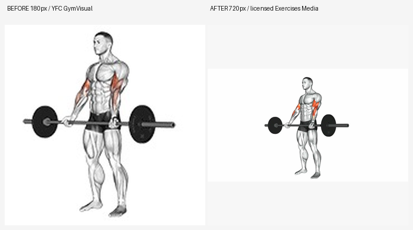
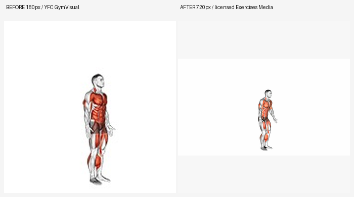
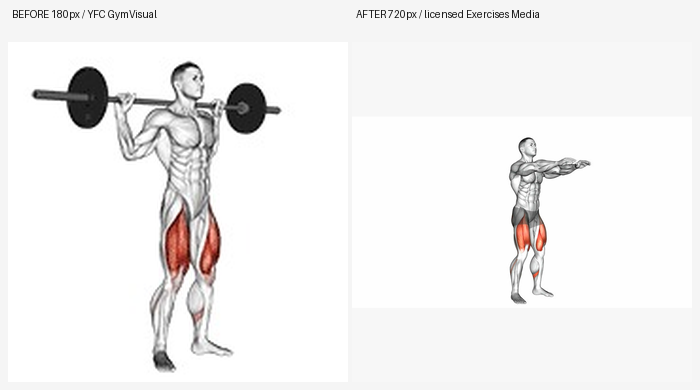
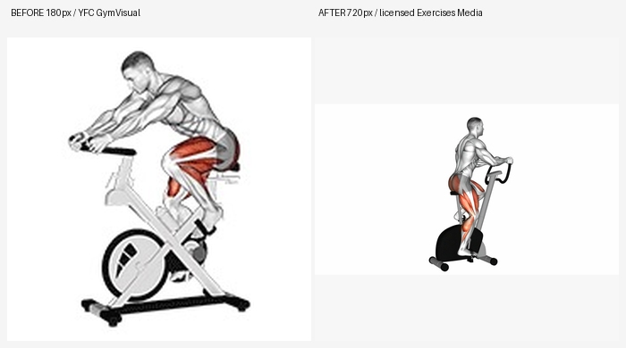

# Issue #986 — HQ poster implementation: bounded 13-exercise batch

**Status: 13-poster implementation; rights fully confirmed by owner, visual/mobile acceptance explicitly deferred until after release. No claim of completed animation replacement.**

The YFC owner confirmed rights to the source and derivatives of [`akajdid-mostafa/exercises-media`](https://github.com/akajdid-mostafa/exercises-media/tree/18742da40b0627c85925c5dd4441dc3eac0594d0) on 2026-10-16 and requested **eventually replacing all current low-quality 180×180 media**. This PR is an **initial safe 13-poster implementation**, **NOT fulfillment** of replacing all images/animations.

## Before/after visual evidence

These are actual asset bytes from the active YFC manifest (BEFORE) and source-SHA-verified, converted JPEGs at 720×720 (AFTER), with no image synthesis. Both are shown in the same box:

| Exercise | BEFORE / AFTER |
|---|---|
| Сгибания со штангой | [](./barbell-curl-before-after.png) |
| Бёрпи | [](./burpee-before-after.png) |
| Приседание | [](./squat-before-after.png) |
| Велотренажёр | [](./stationary-bike-before-after.png) |

## Implemented changes

- A strictly pinned **13-item** catalog crosswalk from `986_COVERAGE_MATRIX.csv` with human-reviewed `VERIFIED` movement semantics, for current approved canonical exercises only.
- Import script `scripts/import_licensed_hq_exercise_posters.py` reads local JPG inputs; validates Git blob SHA-1 and size against `986_SOURCE_INVENTORY.csv`, exact source resolution 1920×1080, applies exif-aware orientation, pads instead of cropping anatomy, and encodes metadata-free 720×720 JPEG at q88 using Lanczos. No network access in the script; no unknown substitutions.
- Old 180×180 JPG posters replaced for those 13; **the original 167 approved GIF animations remain untouched**, and the remaining 154 approved posters unchanged. All 39 `blocked` canonical exercise media remain blocked, without unlock.
- Original `schema_version=3`, media `type=animation`, `sources=[image/gif]`, per-exercise existing asset source and GIF references preserved; no API/DB migrations, contract v4, new frontend UI, AI Coach or unrelated file changes.
- Each replaced poster has real `poster_sha256`, `poster_byte_size`, 720×720 image dimensions and explicit source revision/rights/mapping in `poster_source`. `asset_count=334` (same total references), `derivative_count=13`, `hq_poster_count=13`, `total_bytes` recalculated.
- Catalog checker extended to validate hash, bytes, format, new origin, resolution and empty EXIF. Backend manifest test updated for **actual** 13 derivative posters. Existing valid GymVisual GIFs remain verified unchanged.

### Repro / checks

```powershell
# Pinned candidate files must first be supplied to the local ignored folder
uv run --no-project --with pillow python scripts/import_licensed_hq_exercise_posters.py
uv run --no-project --with pillow python scripts/import_licensed_hq_exercise_posters.py --apply
uv run --no-project --with pydantic --with tzdata --with sqlalchemy --with pillow python scripts/validate_exercise_catalog.py
```

Local catalog validation on this branch reports **206 canonical, 167 approved, 39 blocked, 334 assets, 13 derivatives, no broken hash/path**. All 13 source originals were verified against pinned Git SHA before conversion. `ruff` and pre-commit required; CI/actual TMA mobile screenshots TBD.

### Remaining work / no false 100% completion claim

- **94 catalog entries `REVIEW`** require checked manual semantic mapping (equivalent movement/equipment, no false matches), **99 `NO_MATCH`** currently lack a safe direct replacement. Out of those 99, 39 are blocked; never automatically unlock them.
- Current 167 **GIF 180×180 animations remain low-res**. Full replacement requires new verified matched animation sources and compatibility-tested video or alternative HQ animation contract, not a blanket filename-based swap. GIF is not upscaled, merely retained.
- Owner has explicitly authorized **all kinds of use and redistribution** of candidate and derivatives. Owner can verify technique, visual quality and real iPhone/TMA only **after** a controlled production release; those are post-release acceptance checks with a rollback path. This does not waive required automated CI, semantic matching and media security checks.

This narrow branch is intentionally outside the approved production train #1038 and #873 desktop/mobile design PR.
