# #1326 - «Центр управления», вариант A

**Статус:** `DESIGN_DIRECTION_OWNER_ACCEPTED`, `FINAL_VISUAL=NOT_APPROVED`, `IMPLEMENTATION=NOT_STARTED`. Этот PR - **только визуальный комплект** для отдельного решения владельца. Исходный React/CSS/API/БД не изменяется.

## Векторный визуальный комплект

Схемы ниже выполнены с палитрой и смысловыми радиусами `design-system.css`; это **векторная визуализация идеи**, не скриншоты существующего YFC и не доказательство pixel-perfect реализации. Обсуждать и утверждать окончательную компоновку необходимо **до** реального UI-кода.

| Состояние | Dark | Light |
|---|---|---|
| Обзор mobile 320 | 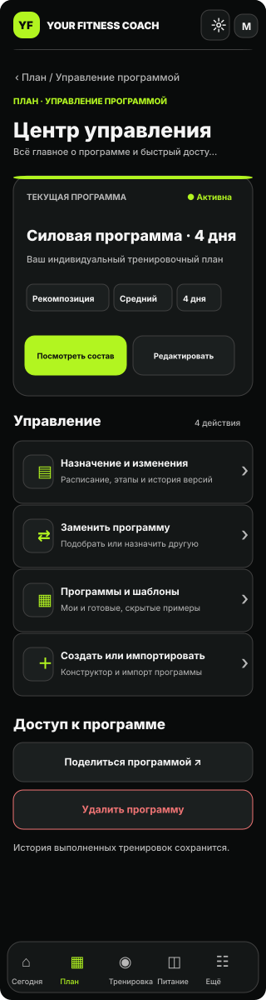 | 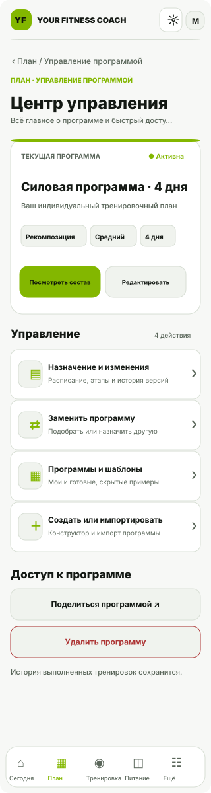 |
| Обзор mobile 360 | 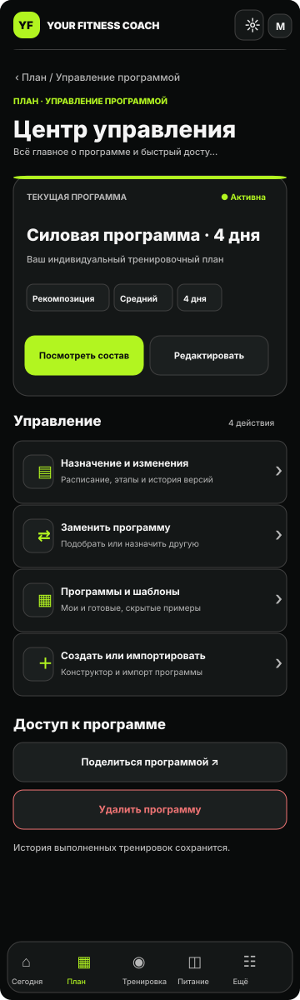 | 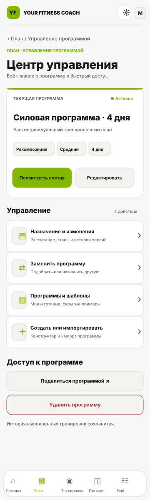 |
| Обзор mobile 393 | 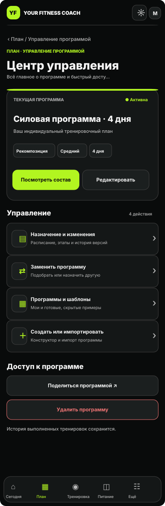 | 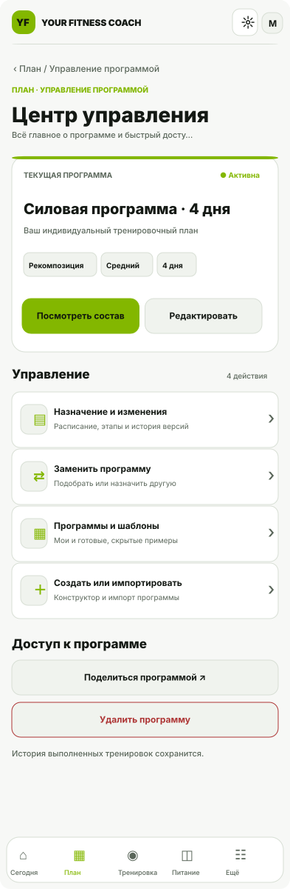 |
| Обзор mobile 430 | 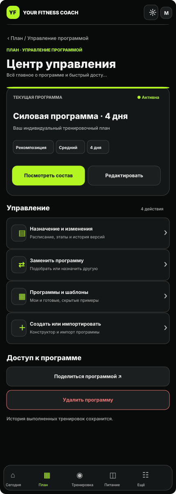 | 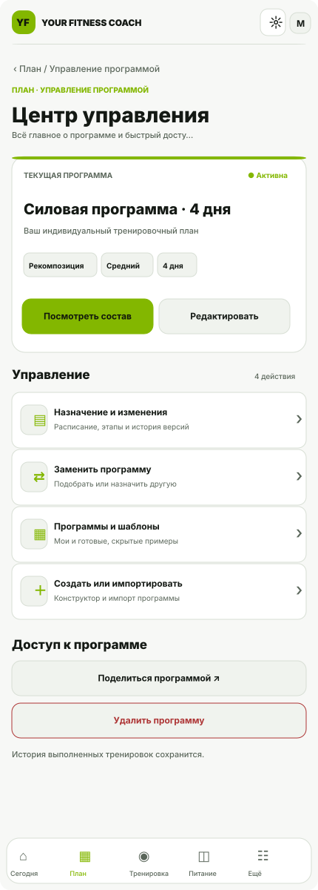 |
| Обзор desktop 1440 | 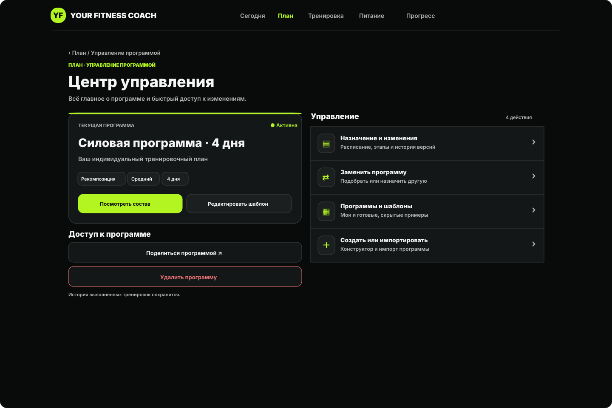 | 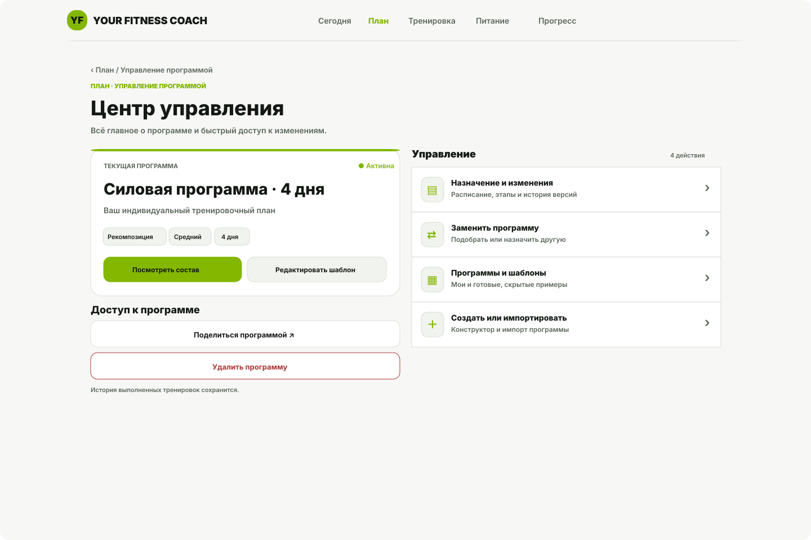 |
| Назначение/история | 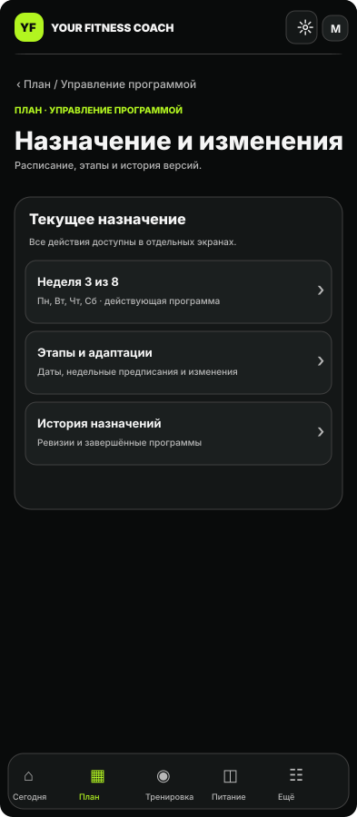 | 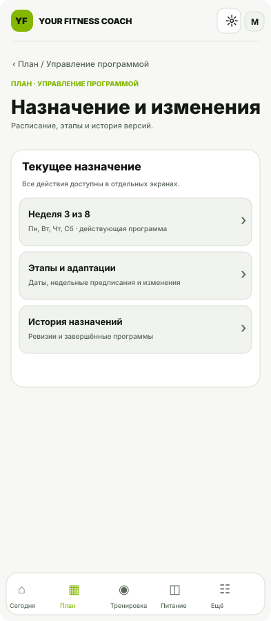 |
| Замена/подбор | 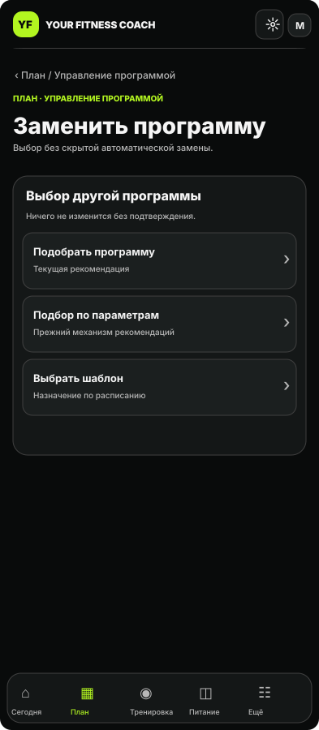 | 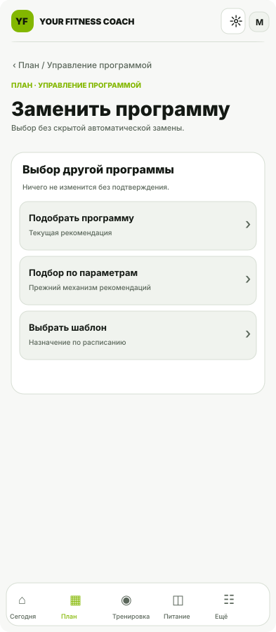 |
| Библиотека | 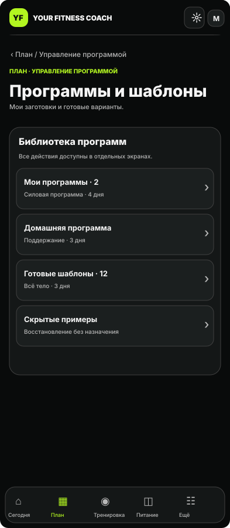 | 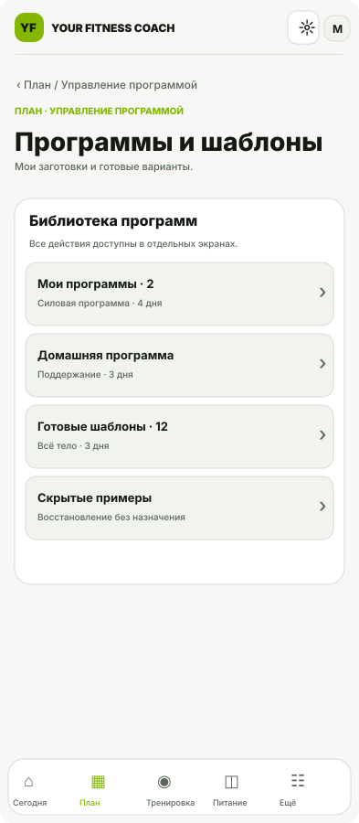 |
| Создать/импортировать | 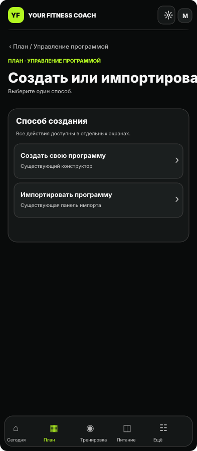 | 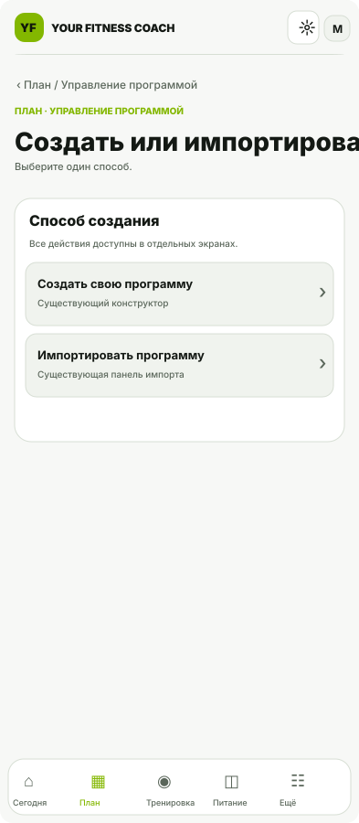 |
| Пустое состояние | 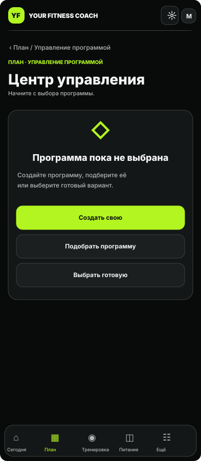 | 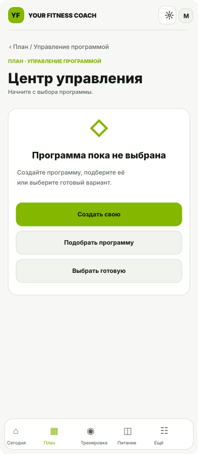 |
| Тренерский read-only | 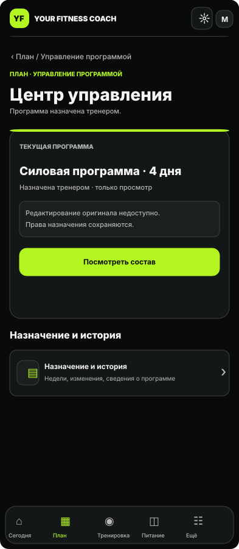 | 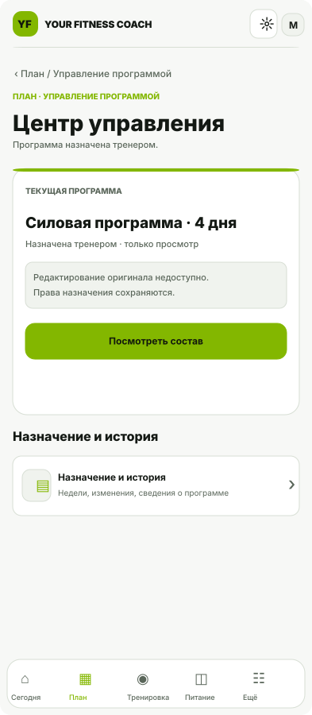 |
| Удаление/подтверждение | 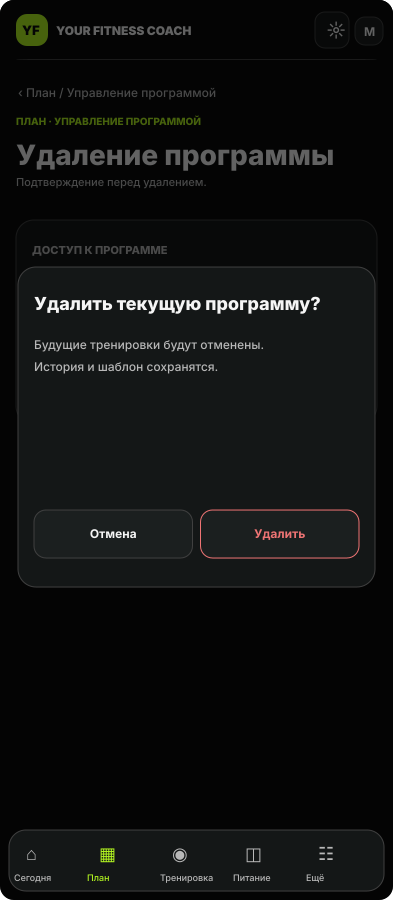 | 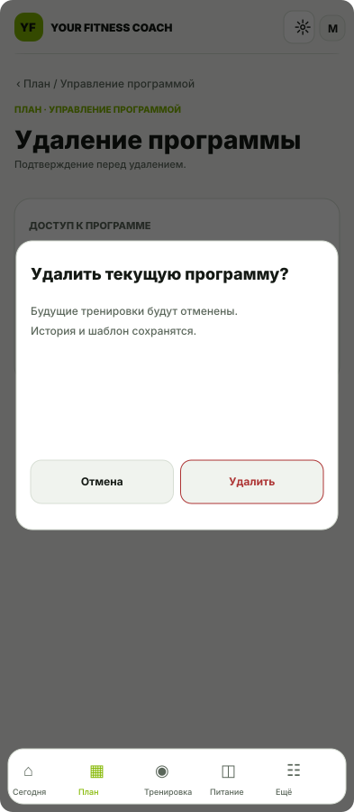 |

## Информационная архитектура

- **Обзор:** название, статус, цель/уровень/дни; «Посмотреть состав», разрешённое «Редактировать шаблон» или «Настроить свою копию».
- **Управление:** самостоятельные destinations «Назначение и изменения», «Заменить программу», «Программы и шаблоны», «Создать или импортировать».
- **Доступ:** «Поделиться» и полноширинное «Удалить» непосредственно под ним, только по правам владельца, существующее подтверждение #1229.
- **Заменить:** без автоматического назначения; оставить оба `LegacyProgramRecommendation` и `ProgramRecommendation`, назначение по расписанию, 409/concurrency gates.
- **Назначения:** `AssignedProgramDetails`, неделя, этапы, адаптации, история, ревизии.
- **Библиотека:** собственные и готовые шаблоны, скрытые примеры и восстановление; оттуда существующий просмотр/назначение.
- **Создание:** существующий `ProgramBuilder`, `ProgramImportPanel`, интеграция с #1323 без нового редактора.
- **Тренерское назначение:** просмотр/история без незаконного редактирования оригинала. **Empty:** «Создать свою», «Подобрать», «Выбрать готовую».

### Условия реализации после отдельного owner visual approval

1. Реальное внедрение **только** в `/app?section=programs&view=manage` и точках вызова; никакого переписывания API, БД и прав.
2. Фокус / прокрутка / локальный незавершённый ввод при возврате, deep links `start=templates/create/generator`.
3. Unit + Chromium/WebKit, 320/360/393/430 и desktop, Dark/Light, клавиатура/VoiceOver, PWA/TMA, физический iPhone.
4. Фиксация настоящих AFTER-скриншотов действующего интерфейса, отдельная физическая приёмка и **отдельный owner gate** на merge/deploy.

**Важно:** проверки Chromium (24/24 вариантов без горизонтального overflow) выполнялись на отдельном автономном HTML-макете, а не на приложении. SVG-макеты в этом PR служат доступной в GitHub иллюстрацией; они не являются результатом E2E тестов.
