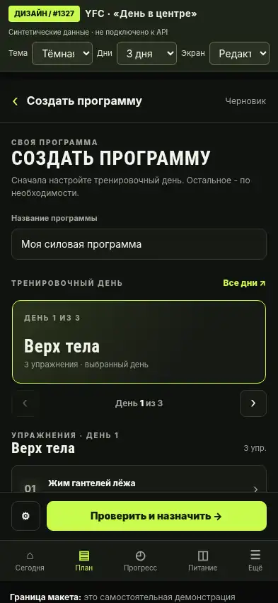
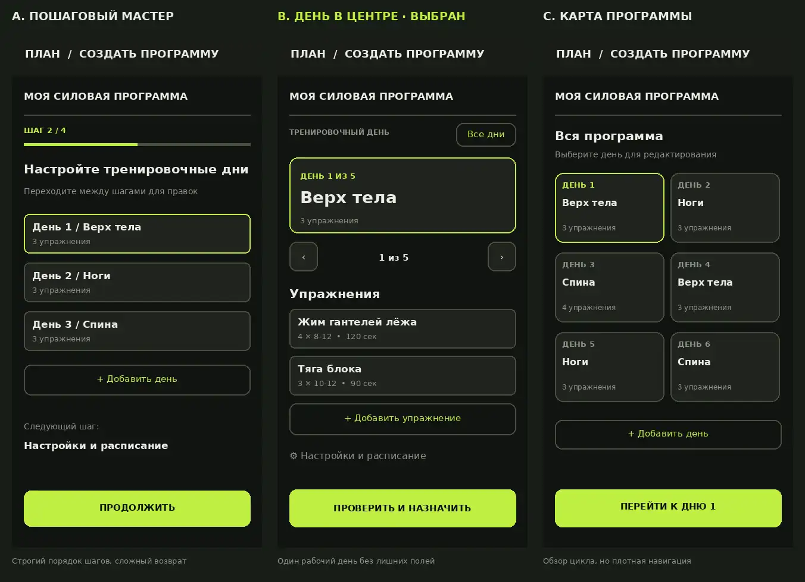

# #1327 - «Создать свою программу»: B «День в центре»

**Материалы для утверждения макетов**. Все изображения - синтетические состояния отдельного прототипа, не скриншоты действующего YFC.

### Смотреть с телефона

**[Открыть мобильную галерею (все 16 экранов, можно увеличивать)](https://htmlpreview.github.io/?https://github.com/MikeMoore1337/your-fitness-coach/blob/docs/1327-phone-gallery/docs/ux-proposals/issue-1327/gallery.html)**

[Сама галерея в GitHub](gallery.html) · [Issue #1327](https://github.com/MikeMoore1337/your-fitness-coach/issues/1327)

### Основной мобильный экран

### Мобильные состояния - тёмная тема

- [Пустая программа](screens/1327-dark-mobile-empty.webp)
- [Заполненный день](screens/1327-dark-mobile-filled.webp)
- [Переход к дню 8](screens/1327-dark-mobile-day8.webp)
- [Редактирование упражнения](screens/1327-dark-mobile-exercise.webp)
- [Проверка программы](screens/1327-dark-mobile-review.webp)
- [Ошибки валидации](screens/1327-dark-mobile-invalid.webp)
- [Отсутствие сети](screens/1327-dark-mobile-offline.webp)

### Мобильные состояния - светлая тема

- [Заполненный день](screens/1327-light-mobile-filled.webp)
- [Быстрый выбор «Все дни»](screens/1327-light-mobile-all-days.webp)
- [Настройки и расписание](screens/1327-light-mobile-settings.webp)
- [Подтверждение замены активной программы](screens/1327-light-mobile-replace.webp)
- [Успешное назначение](screens/1327-light-mobile-success.webp)

### Десктоп

- [Тёмная тема - конструктор](screens/1327-dark-desktop-filled.webp)
- [Тёмная тема - настройки упражнения](screens/1327-dark-desktop-exercise.webp)
- [Светлая тема - конструктор](screens/1327-light-desktop-filled.webp)
- [Светлая тема - проверка](screens/1327-light-desktop-review.webp)

### Варианты A / B / C

**Статус:** `FINAL_VISUAL_APPROVAL=PENDING`. Отдельное утверждение детальных макетов владельцем всё ещё требуется до реализации в приложении. В этом PR только документация и изображения, без изменений UI, API и данных.

**Технические примечания:** Изображения конвертированы из локальных PNG-макетов в WebP для комфортного просмотра с телефона. Галерея полностью автономна: содержит копии изображений внутри HTML и не требует стороннего JS/CDN (кроме сервиса HTML Preview, который отображает сам файл на GitHub). Критерии N=1/3/5/8 относятся к текущему backend; 10/12/14 - только дизайн.
