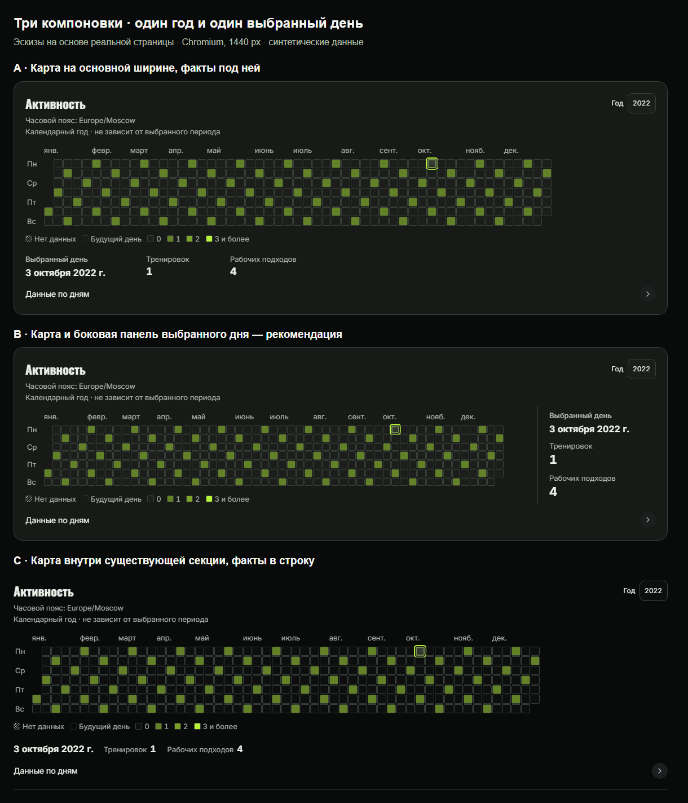
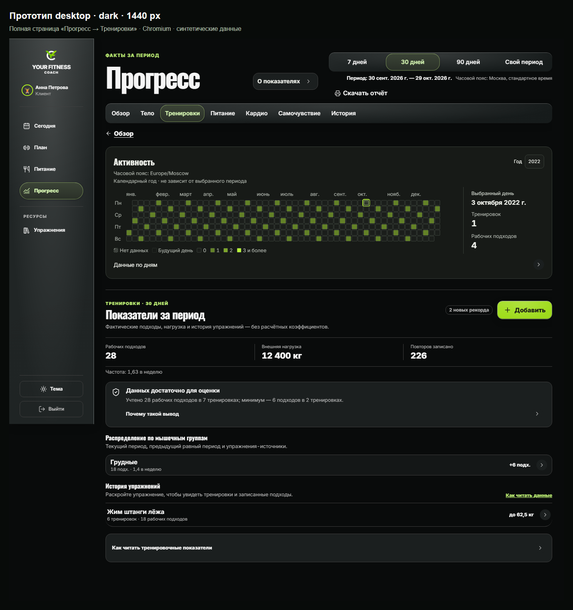
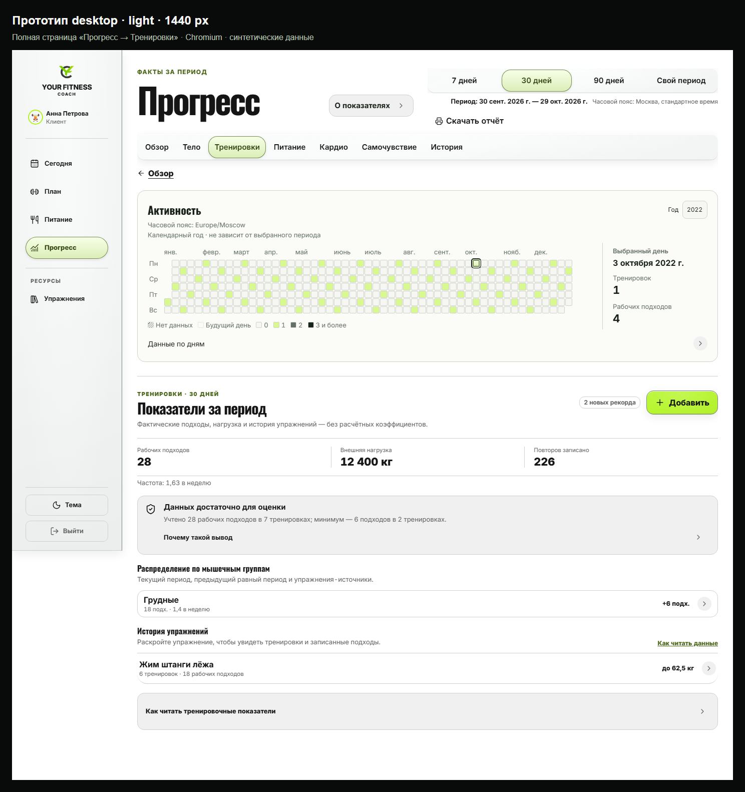
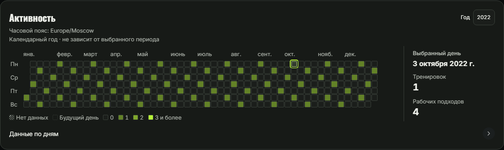
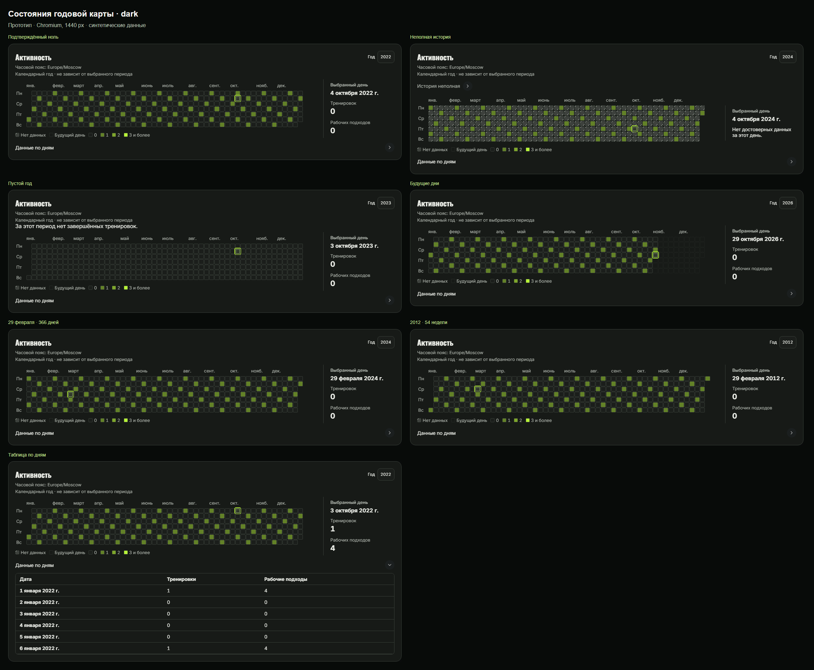
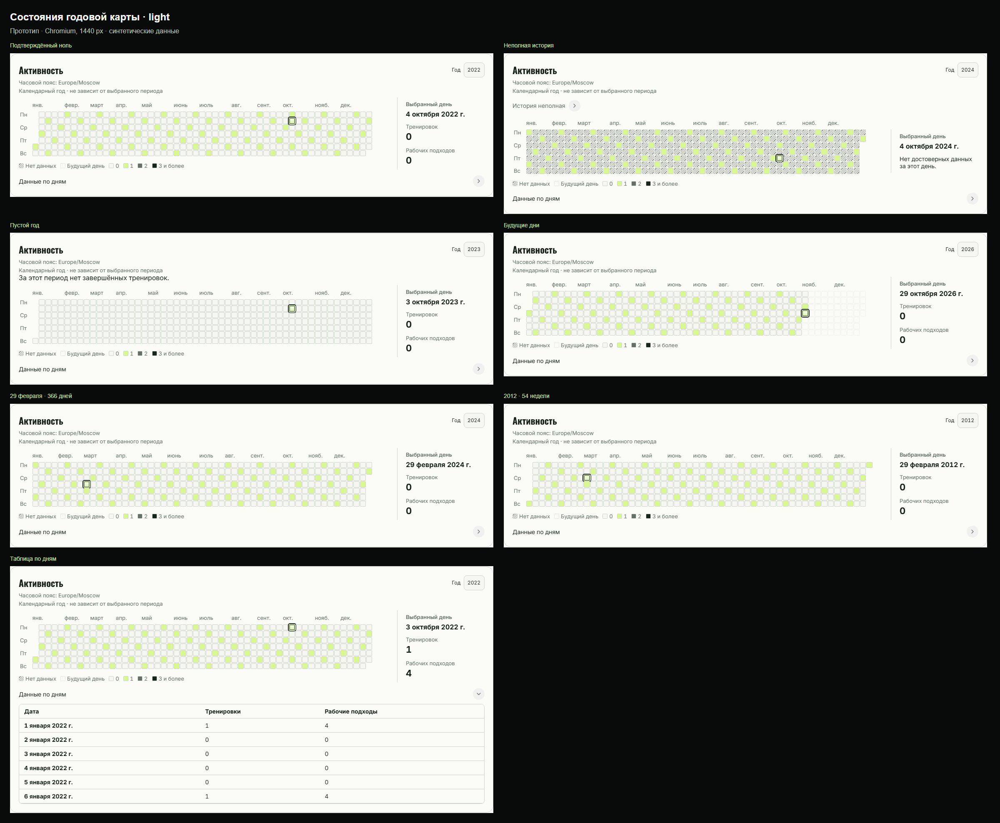
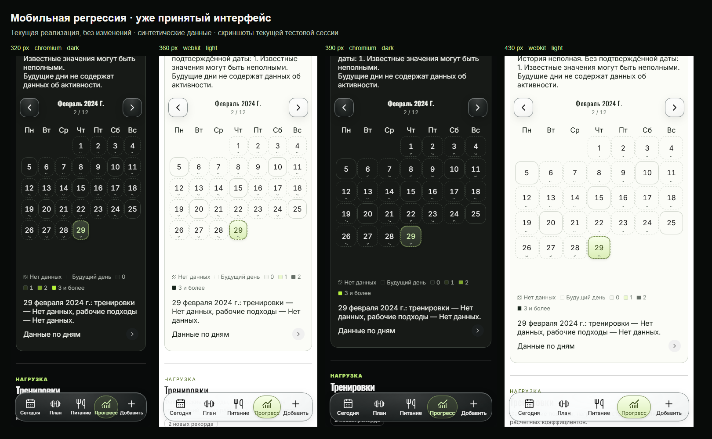

# #835 — согласованное направление desktop B

Владелец принял композицию B в Codex Desktop 29 октября 2026 года. Основание: `17fa2a49285c903e6c8f1fae3ab160f3489e354e`. Все имена и показатели синтетические. Это прототип, а не реальные снимки реализации; приёмка AFTER и разрешение на выпуск остаются отдельными.

### Сравнение композиций

### Полная страница — тёмная тема

### Полная страница — светлая тема

### Выбранный день

### Состояния — тёмная тема

### Состояния — светлая тема

### Мобильная регрессия

[Открыть HTML-пакет локально](review/index.html) · [desktop-прототип](review/desktop-prototype.html)

Прототип показывает синтетический 2022 год: выбор дня, клавиатурную навигацию, таблицу и переключение темы. Год зафиксирован; остальные элементы страницы статичны. Для просмотра HTML скачайте каталог `review` и откройте файл локально.

Desktop: все ширины и браузеры

- dark, 1024 px: [Chromium](review/proposal-1024-dark.png) · [WebKit](review/webkit-proposal-1024-dark.png)
- dark, 1280 px: [Chromium](review/proposal-1280-dark.png) · [WebKit](review/webkit-proposal-1280-dark.png)
- dark, 1440 px: [Chromium](review/proposal-1440-dark.png) · [WebKit](review/webkit-proposal-1440-dark.png)
- dark, 1920 px: [Chromium](review/proposal-1920-dark.png) · [WebKit](review/webkit-proposal-1920-dark.png)
- light, 1024 px: [Chromium](review/proposal-1024-light.png) · [WebKit](review/webkit-proposal-1024-light.png)
- light, 1280 px: [Chromium](review/proposal-1280-light.png) · [WebKit](review/webkit-proposal-1280-light.png)
- light, 1440 px: [Chromium](review/proposal-1440-light.png) · [WebKit](review/webkit-proposal-1440-light.png)
- light, 1920 px: [Chromium](review/proposal-1920-light.png) · [WebKit](review/webkit-proposal-1920-light.png)

Состояния на каждой desktop-ширине, Chromium

- dark, 1024 px: [ноль](review/state-zero-dark-1024.png) · [неизвестно](review/state-partial-dark-1024.png) · [пусто](review/state-empty-dark-1024.png) · [29 февраля](review/state-leap-dark-1024.png) · [54 недели](review/state-boundary-dark-1024.png) · [будущее](review/state-future-dark-1024.png) · [таблица](review/state-table-dark-1024.png)
- dark, 1280 px: [ноль](review/state-zero-dark-1280.png) · [неизвестно](review/state-partial-dark-1280.png) · [пусто](review/state-empty-dark-1280.png) · [29 февраля](review/state-leap-dark-1280.png) · [54 недели](review/state-boundary-dark-1280.png) · [будущее](review/state-future-dark-1280.png) · [таблица](review/state-table-dark-1280.png)
- dark, 1440 px: [ноль](review/state-zero-dark.png) · [неизвестно](review/state-partial-dark.png) · [пусто](review/state-empty-dark.png) · [29 февраля](review/state-leap-dark.png) · [54 недели](review/state-boundary-dark.png) · [будущее](review/state-future-dark.png) · [таблица](review/state-table-dark.png)
- dark, 1920 px: [ноль](review/state-zero-dark-1920.png) · [неизвестно](review/state-partial-dark-1920.png) · [пусто](review/state-empty-dark-1920.png) · [29 февраля](review/state-leap-dark-1920.png) · [54 недели](review/state-boundary-dark-1920.png) · [будущее](review/state-future-dark-1920.png) · [таблица](review/state-table-dark-1920.png)
- light, 1024 px: [ноль](review/state-zero-light-1024.png) · [неизвестно](review/state-partial-light-1024.png) · [пусто](review/state-empty-light-1024.png) · [29 февраля](review/state-leap-light-1024.png) · [54 недели](review/state-boundary-light-1024.png) · [будущее](review/state-future-light-1024.png) · [таблица](review/state-table-light-1024.png)
- light, 1280 px: [ноль](review/state-zero-light-1280.png) · [неизвестно](review/state-partial-light-1280.png) · [пусто](review/state-empty-light-1280.png) · [29 февраля](review/state-leap-light-1280.png) · [54 недели](review/state-boundary-light-1280.png) · [будущее](review/state-future-light-1280.png) · [таблица](review/state-table-light-1280.png)
- light, 1440 px: [ноль](review/state-zero-light.png) · [неизвестно](review/state-partial-light.png) · [пусто](review/state-empty-light.png) · [29 февраля](review/state-leap-light.png) · [54 недели](review/state-boundary-light.png) · [будущее](review/state-future-light.png) · [таблица](review/state-table-light.png)
- light, 1920 px: [ноль](review/state-zero-light-1920.png) · [неизвестно](review/state-partial-light-1920.png) · [пусто](review/state-empty-light-1920.png) · [29 февраля](review/state-leap-light-1920.png) · [54 недели](review/state-boundary-light-1920.png) · [будущее](review/state-future-light-1920.png) · [таблица](review/state-table-light-1920.png)

В варианте B сведения о дне расположены справа от годовой карты, а при недостатке ширины — под ней. Показатели выбранного периода отделены от календарного года. Ноль, неизвестная история и будущие даты различаются; таблица сохраняет все дни года. Мобильная компоновка остаётся прежней.
