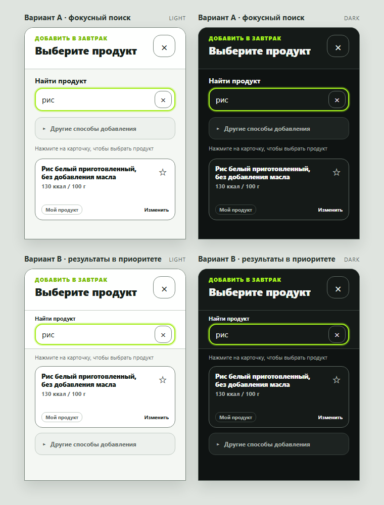

## Решение владельца - ВАРИАНТ B УТВЕРЖДЁН (2026-10-12)

**OWNER_946_DESIGN_APPROVAL=GRANTED_B_WITH_CLARIFICATIONS.** Владелец явно подтвердил «Утверждаю» в ответ на предложение варианта B с уточнениями. Это разрешение на **точную реализацию B в PR #958**, но **не** приёмка готовых AFTER, не merge и не production deploy.

**Канонический макет для keyboard-open state:** [PNG Light/Dark A/B](keyboard-state-owner-review.png), использовать **нижние два artboard B**, 320×420 CSS px. Остальные изображения A - отвергнутые альтернативы. Изображение является проектным макетом, не скриншотом работающей сборки.

### Обязательное поведение варианта B
1. При появлении экранной клавиатуры и вводе поискового запроса поле поиска остаётся **закреплённым сверху области результатов**. При прокрутке списка результаты движутся под ним; шапка, крестик и поле не перекрывают друг друга.
2. Поле поиска, введённый запрос, **название первой карточки и её калории/основа расчёта** должны быть одновременно видимы в **одном состоянии viewport 320×420** и на 360/393/430px **без принудительного scrollIntoViewIfNeeded и без дополнительного ручного скролла**. Если на экране иная высота из-за настоящей клавиатуры, корректно учитывать visualViewport/safe-area и сохранять доступность списка.
3. Вторичные способы добавления, включая раскрытие «Другие способы добавления», находятся **после всего списка результатов**, не после первой карточки и не между карточками. Они доступны прокруткой; при нулевой выдаче идут сразу под сообщением «Ничего не найдено» / соответствующим пустым состоянием.
4. При закрытии клавиатуры возвращается **уже утверждённая обычная компоновка FoodPickerDialog** со способами добавления в привычном месте. Поисковый запрос, состояние и черновик не теряются. Смена режима должна быть стабильной, без скачков и циклов фокуса/scroll-jank.
5. **Не менять** компактные карточки утверждённого #948 (макет 1:1), контраст #947, реальные данные, избранное/редактирование/выбор и API. Пять навигационных элементов, rest timer и иные страницы вне scope.
6. Точное соответствие B относится только к сцене keyboard-open / 320×420 CSS px. При других размерах разрешена необходимая адаптация, но не самостоятельный редизайн.
7. E2E должен измерять геометрию поиска и первой карточки **в одном непрерывном состоянии** при 420 CSS px до каких-либо scroll-манипуляций. Тестировать Chromium/WebKit, Dark/Light, 320/360/393/430, корректность поведения при zero results, восстановление закрытого вида, keyboard close/reopen, TMA. Не выдавать synthetic keyboard за физическую iOS-проверку.
8. После реализации - реальные AFTER и visual comparison с утверждёнными B artboards, SHA-pinned ссылки, required CI; **остановиться на OWNER_AFTER_APPROVAL=PENDING**.

`OWNER_946_DESIGN_APPROVAL=GRANTED_B`
`OWNER_946_AFTER_APPROVAL=PENDING`
`OWNER_RELEASE_APPROVAL=PENDING`
`MERGE=FORBIDDEN`
`DEPLOY=FORBIDDEN`

---

# Owner review: keyboard state #946 at 420 CSS px

Статус: **вариант B утверждён владельцем, ожидает реализации и повторной визуальной приёмки**. На момент исходного A/B-предложения production-код не изменялся.

## Что доказано на `63f4649e`

После ввода `рис`, без `scrollIntoViewIfNeeded()` и без изменения `scrollY`, поле поиска
остаётся в `visualViewport`, но первый результат — нет:

| Браузер | Ширина | `visualViewport` | Поле поиска | Первая карточка | Заголовок карточки |
| --- | ---: | ---: | ---: | ---: | ---: |
| Chromium/WebKit | 320 | `0..420` | `y=121.8..167.8` | `y=435.9..557.9` | `y=446.9..482.9` |
| Chromium/WebKit | 360/393/430 | `0..420` | `y=121.8..167.8` | `y=413.9..535.9` | `y=424.9..460.9` |

На 320 px карточка полностью ниже границы 420 px. На остальных ширинах виден максимум
верхний край, а заголовок и данные остаются ниже границы. Это подтверждено в Light/Dark,
Chromium/WebKit; synthetic viewport не является доказательством физической iOS-сессии.

Кадры текущего состояния:

- [Chromium 320 Dark — запрос без прокрутки](../../after/chromium-320-dark-keyboard-open-rice-search.png)
- [Chromium 393 Dark — запрос без прокрутки](../../after/chromium-393-dark-keyboard-open-rice-search.png)
- [WebKit 393 Dark — запрос без прокрутки](../../after/webkit-393-dark-keyboard-open-rice-search.png)
- [Chromium 320 Dark — результат только после принудительной прокрутки](../../after/chromium-320-dark-keyboard-open-rice-results.png)

## Два bounded-направления для решения

Оба кадра ниже имеют размер **320×420 CSS px** — worst-case для принятого keyboard-state.
Они меняют только состояние открытого поиска после появления запроса. Закрытый picker,
компактная карточка #948 и selected-state #947 оставляются без изменений.

### Вариант A — фокусный поиск

Вторичные способы добавления остаются доступными одной компактной строкой раскрытия между
поиском и результатами. Подсказка и лишняя вертикальная высота не занимают место. Поле
поиска сохраняет текущую позицию, первая карточка сразу следует за строкой раскрытия.

Плюс: минимальное изменение порядка и понятная доступность вторичных способов.

Риск: на 320 px перед карточкой остаётся меньше свободного пространства.

### Вариант B — результаты в приоритете

После ввода поиск становится закреплённой верхней панелью области результатов. Первая
карточка следует сразу за подсказкой, а строка «Другие способы добавления» переносится ниже
результата и остаётся доступной прокруткой/раскрытием.

Плюс: самый быстрый путь к первому результату и устойчивость при дальнейшем скролле списка.

Риск: меняется порядок вторичного действия только в активном keyboard-state.

## История предложения

Первоначальное состояние: ожидался выбор A/B. Решение принято: **вариант B с уточнениями выше**. Ни макет A, ни код версии до исправления не являются утверждённой реализацией.

---

## Реальная AFTER-галерея PR #958

Вариант B реализован в commit [`5d4850f5193e0527388f86731505a8bc19bbe4eb`](https://github.com/MikeMoore1337/your-fitness-coach/commit/5d4850f5193e0527388f86731505a8bc19bbe4eb). Слева в сравнении остаётся утверждённый reference B, справа — реальный AFTER из того же commit.

| Состояние | APPROVED VARIANT B | ACTUAL AFTER |
| --- | --- | --- |
| `рис`, 320×420, Light, без прокрутки | [Owner reference B](https://github.com/MikeMoore1337/your-fitness-coach/blob/ddd32dbe/docs/ux/final-issues-acceptance/evidence/946-948/owner-review/keyboard-state-420/keyboard-state-owner-review.png) | [Chromium](https://github.com/MikeMoore1337/your-fitness-coach/blob/5d4850f5193e0527388f86731505a8bc19bbe4eb/docs/ux/final-issues-acceptance/evidence/946-948/after/chromium-320-light-keyboard-open-rice-search.png) · [WebKit](https://github.com/MikeMoore1337/your-fitness-coach/blob/5d4850f5193e0527388f86731505a8bc19bbe4eb/docs/ux/final-issues-acceptance/evidence/946-948/after/webkit-320-light-keyboard-open-rice-search.png) |
| `рис`, 320×420, Dark, без прокрутки | [Owner reference B](https://github.com/MikeMoore1337/your-fitness-coach/blob/ddd32dbe/docs/ux/final-issues-acceptance/evidence/946-948/owner-review/keyboard-state-420/keyboard-state-owner-review.png) | [Chromium](https://github.com/MikeMoore1337/your-fitness-coach/blob/5d4850f5193e0527388f86731505a8bc19bbe4eb/docs/ux/final-issues-acceptance/evidence/946-948/after/chromium-320-dark-keyboard-open-rice-search.png) · [WebKit](https://github.com/MikeMoore1337/your-fitness-coach/blob/5d4850f5193e0527388f86731505a8bc19bbe4eb/docs/ux/final-issues-acceptance/evidence/946-948/after/webkit-320-dark-keyboard-open-rice-search.png) |
| `рис`, список прокручен внутри результата | [Owner reference B](https://github.com/MikeMoore1337/your-fitness-coach/blob/ddd32dbe/docs/ux/final-issues-acceptance/evidence/946-948/owner-review/keyboard-state-420/keyboard-state-owner-review.png) | [Chromium 320 Light](https://github.com/MikeMoore1337/your-fitness-coach/blob/5d4850f5193e0527388f86731505a8bc19bbe4eb/docs/ux/final-issues-acceptance/evidence/946-948/after/chromium-320-light-keyboard-open-rice-results.png) · [WebKit 320 Dark](https://github.com/MikeMoore1337/your-fitness-coach/blob/5d4850f5193e0527388f86731505a8bc19bbe4eb/docs/ux/final-issues-acceptance/evidence/946-948/after/webkit-320-dark-keyboard-open-rice-results.png) |
| `картофель`, несколько результатов, keyboard-open | [Owner reference B](https://github.com/MikeMoore1337/your-fitness-coach/blob/ddd32dbe/docs/ux/final-issues-acceptance/evidence/946-948/owner-review/keyboard-state-420/keyboard-state-owner-review.png) | [Chromium 320 Light](https://github.com/MikeMoore1337/your-fitness-coach/blob/5d4850f5193e0527388f86731505a8bc19bbe4eb/docs/ux/final-issues-acceptance/evidence/946-948/after/chromium-320-light-potato-results.png) · [WebKit 320 Dark](https://github.com/MikeMoore1337/your-fitness-coach/blob/5d4850f5193e0527388f86731505a8bc19bbe4eb/docs/ux/final-issues-acceptance/evidence/946-948/after/webkit-320-dark-potato-results.png) |
| Пустая выдача, keyboard-open | [Owner reference B](https://github.com/MikeMoore1337/your-fitness-coach/blob/ddd32dbe/docs/ux/final-issues-acceptance/evidence/946-948/owner-review/keyboard-state-420/keyboard-state-owner-review.png) | [Chromium 320 Dark](https://github.com/MikeMoore1337/your-fitness-coach/blob/5d4850f5193e0527388f86731505a8bc19bbe4eb/docs/ux/final-issues-acceptance/evidence/946-948/after/chromium-320-dark-keyboard-open-empty.png) · [WebKit 320 Light](https://github.com/MikeMoore1337/your-fitness-coach/blob/5d4850f5193e0527388f86731505a8bc19bbe4eb/docs/ux/final-issues-acceptance/evidence/946-948/after/webkit-320-light-keyboard-open-empty.png) |
| Mocked TMA, safe-area, 393×420, Dark | [Owner reference B](https://github.com/MikeMoore1337/your-fitness-coach/blob/ddd32dbe/docs/ux/final-issues-acceptance/evidence/946-948/owner-review/keyboard-state-420/keyboard-state-owner-review.png) | [TMA Chromium/WebKit](https://github.com/MikeMoore1337/your-fitness-coach/blob/5d4850f5193e0527388f86731505a8bc19bbe4eb/docs/ux/final-issues-acceptance/evidence/946-948/after/tma-393-dark-keyboard-open-rice.png) |
| Закрытая клавиатура, возврат к обычной компоновке | [Owner reference B](https://github.com/MikeMoore1337/your-fitness-coach/blob/ddd32dbe/docs/ux/final-issues-acceptance/evidence/946-948/owner-review/keyboard-state-420/keyboard-state-owner-review.png) | [Chromium 320 Light](https://github.com/MikeMoore1337/your-fitness-coach/blob/5d4850f5193e0527388f86731505a8bc19bbe4eb/docs/ux/final-issues-acceptance/evidence/946-948/after/chromium-320-light-search-closed.png) · [WebKit 320 Dark](https://github.com/MikeMoore1337/your-fitness-coach/blob/5d4850f5193e0527388f86731505a8bc19bbe4eb/docs/ux/final-issues-acceptance/evidence/946-948/after/webkit-320-dark-search-closed.png) |

Полная матрица AFTER: [Chromium/WebKit × Light/Dark × 320/360/393/430](https://github.com/MikeMoore1337/your-fitness-coach/tree/5d4850f5193e0527388f86731505a8bc19bbe4eb/docs/ux/final-issues-acceptance/evidence/946-948/after). Геометрия `рис` измеряется в одном DOM-состоянии до прокрутки; кадр с прокруткой — отдельная проверка независимого контейнера результатов. Физическая iOS-клавиатура не проверялась: доступен браузерный стенд.
