# #873 — mobile redesign v2 (обновлено по отзыву владельца)

**Статус:** `MOBILE_DESIGN_REVIEW_PENDING`, 2026-10-16. Desktop Dark/Light из прежнего пакета **APPROVED** и не изменяется. Ниже — новый design-only прототип: **одна колонка, без Bento**, более простая иерархия карточек, компактные показатели списком, полноширинное основное действие. Фирменные YFC Dark/Light, шрифты и лаймовые акценты сохранены. Это **не production UI**.

Все картинки сняты заново в Chromium с локального `gallery.html` после правки CSS. Клик по картинке открывает исходный PNG.

## Тело

| Dark | Light |
|---|---|
| [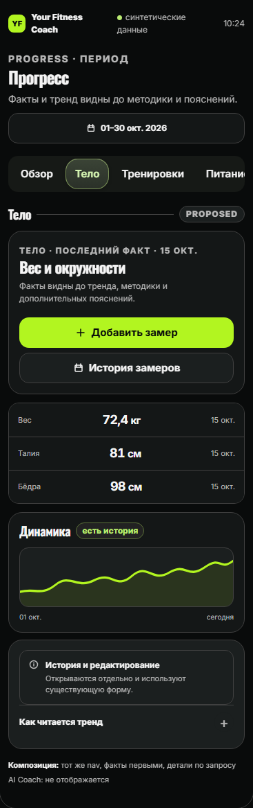](./visuals/mobile-v2-dark-393-body-many.png) | [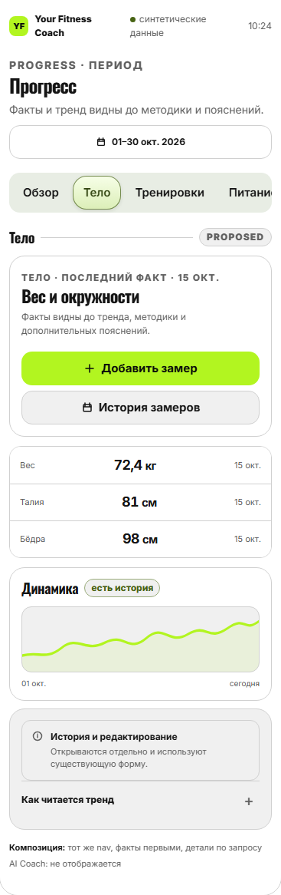](./visuals/mobile-v2-light-393-body-many.png) |

## Тренировки

| Dark | Light |
|---|---|
| [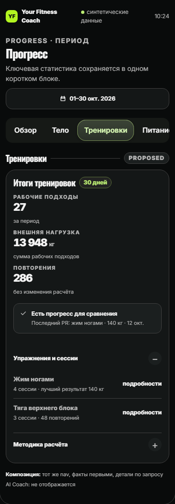](./visuals/mobile-v2-dark-393-training.png) | [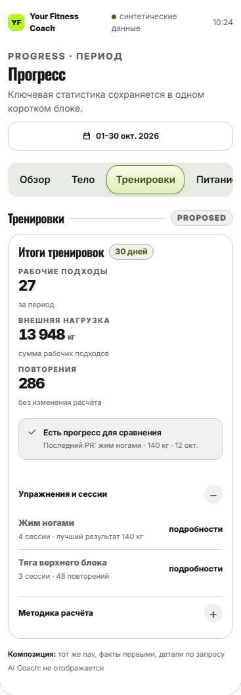](./visuals/mobile-v2-light-393-training.png) |

## Питание

| Dark | Light |
|---|---|
| [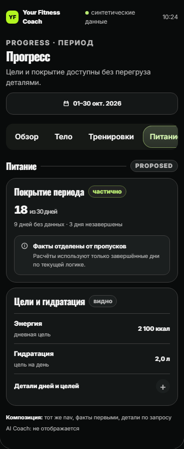](./visuals/mobile-v2-dark-393-nutrition-filled.png) | [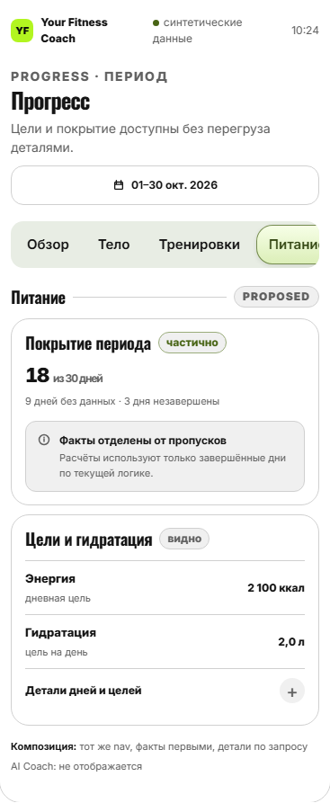](./visuals/mobile-v2-light-393-nutrition-filled.png) |

## Кардио

| Dark | Light |
|---|---|
| [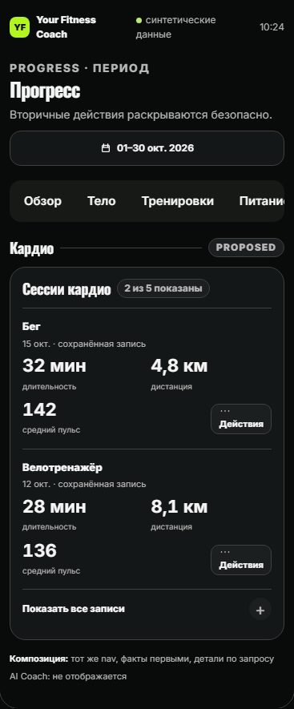](./visuals/mobile-v2-dark-393-cardio-many.png) | [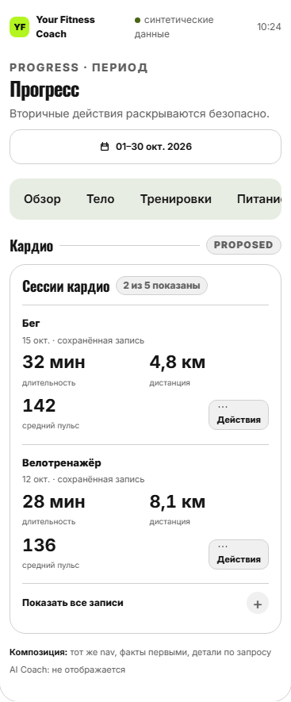](./visuals/mobile-v2-light-393-cardio-many.png) |

## Самочувствие

| Dark | Light |
|---|---|
| [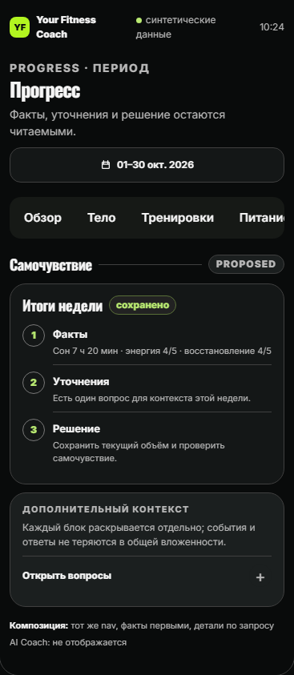](./visuals/mobile-v2-dark-393-wellbeing.png) | [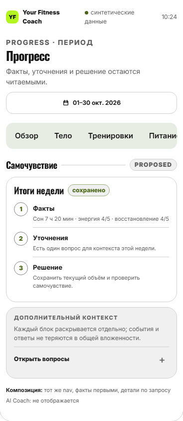](./visuals/mobile-v2-light-393-wellbeing.png) |

## История

| Dark | Light |
|---|---|
| [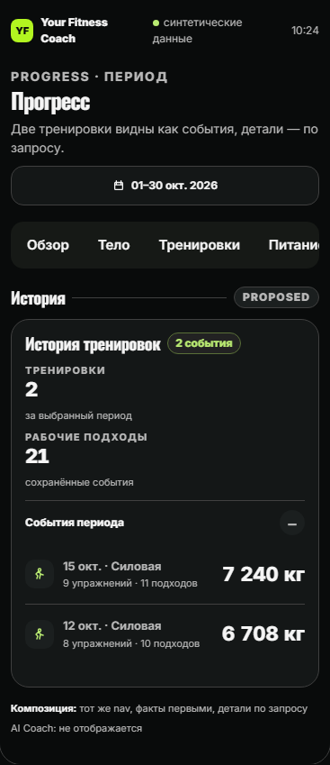](./visuals/mobile-v2-dark-393-history.png) | [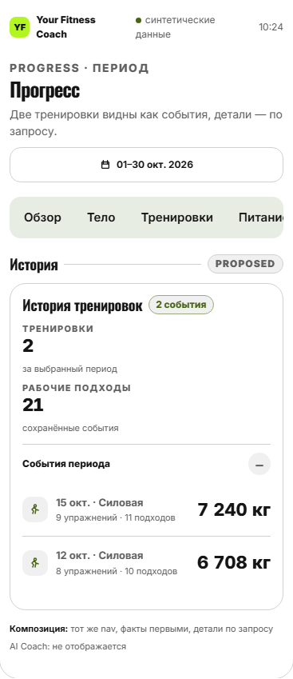](./visuals/mobile-v2-light-393-history.png) |

## Адаптивность и крайние случаи

| Состояние | Dark | Light |
|---|---|---|
| Тело: нет замеров | [PNG](./visuals/mobile-v2-dark-393-body-empty.png) | [PNG](./visuals/mobile-v2-light-393-body-empty.png) |
| Тело: одна запись | [PNG](./visuals/mobile-v2-dark-393-body-one.png) | [PNG](./visuals/mobile-v2-light-393-body-one.png) |
| Питание: нет данных | [PNG](./visuals/mobile-v2-dark-393-nutrition-empty.png) | [PNG](./visuals/mobile-v2-light-393-nutrition-empty.png) |
| Кардио: одна запись | [PNG](./visuals/mobile-v2-dark-393-cardio-one.png) | [PNG](./visuals/mobile-v2-light-393-cardio-one.png) |
| 320px | [PNG](./visuals/mobile-v2-dark-320.png) | [PNG](./visuals/mobile-v2-light-320.png) |
| 360px | [PNG](./visuals/mobile-v2-dark-360.png) | [PNG](./visuals/mobile-v2-light-360.png) |
| 430px | [PNG](./visuals/mobile-v2-dark-430.png) | [PNG](./visuals/mobile-v2-light-430.png) |

Проверки: `mobile-v2-review-checks.json` — 26/26 captures, среди них 20 вкладок/состояний (10 состояний × обе темы) и 6 адаптивных ширин, без горизонтального overflow и без двухколоночных grid/Bento в proposed Mobile; все кнопки `.button` не менее 44px. Это не доказывает работоспособность нативной TMA/VoiceOver/iPhone.

**Следующий gate:** новый мобильный owner design approval; desktop уже approved. До этого никаких изменений production `frontend/src`, merge/deploy не разрешены.
