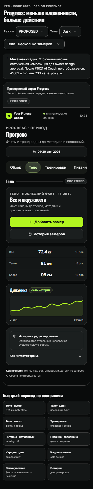
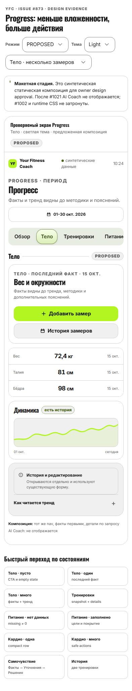
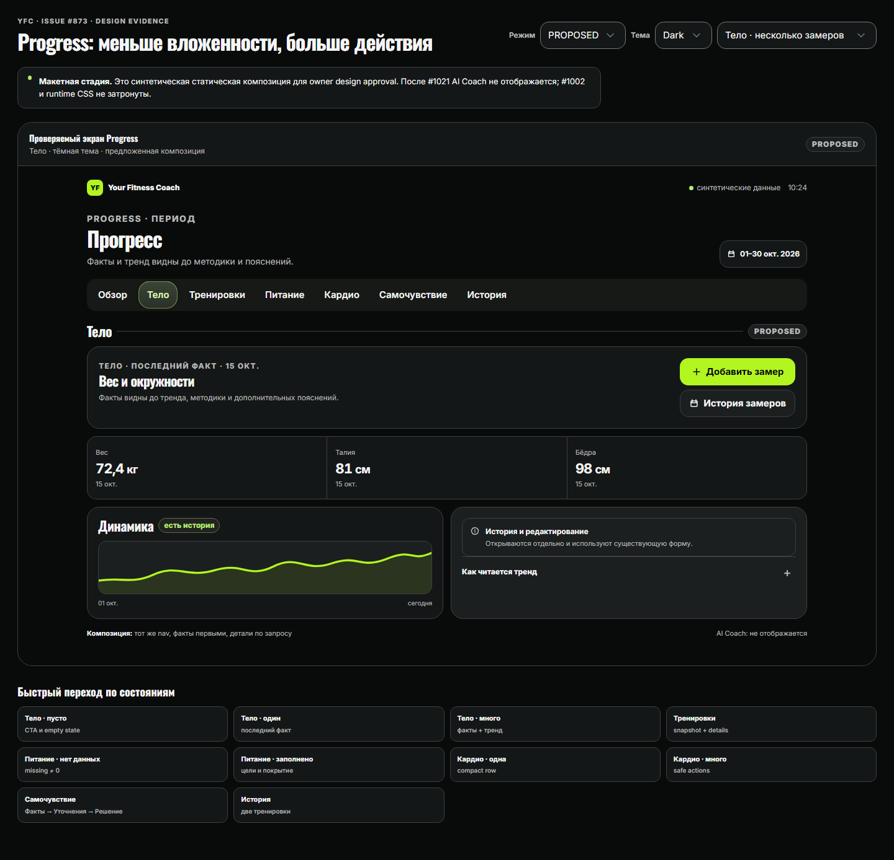
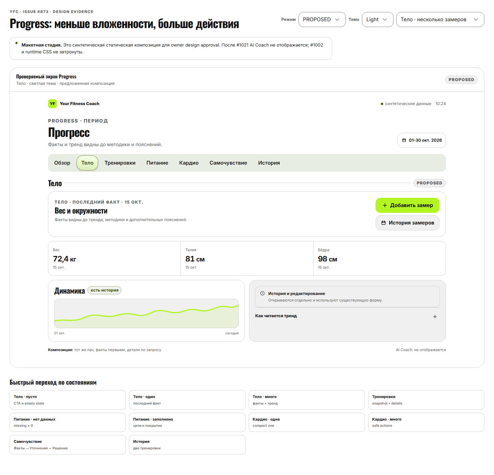

# #873 — скриншоты на повторный аппрув

**ОБНОВЛЕНО ПО MOBILE FEEDBACK:** [новая мобильная галерея БЕЗ Bento, все 6 разделов Dark/Light](./MOBILE_REWORK.md). Десктопные макеты ниже утверждены. Старые мобильные макеты заменены обновлёнными PNG.

**Это предложение дизайна, не работающий production UI.** Все PNG взяты из текущего design-only пакета #1030 после исправления фиолетовых элементов в сторону действующей палитры YFC. Текущие production компоненты и цвета должны быть проверены ещё и при реализации.

## Быстрый просмотр (4 изображения)

Нажмите на каждую картинку для открытия оригинала в GitHub. На мобильном экране картинку можно открыть отдельно и увеличить.

### Mobile 393px — Dark, тело / несколько измерений

### Mobile 393px — Light, тело / несколько измерений

### Desktop 1440px — Dark

### Desktop 1440px — Light

## Другие состояния

| Экран | Dark | Light |
|---|---|---|
| Тело — пусто | [PNG](./visuals/proposed-dark-393-body-empty.png) | [PNG](./visuals/proposed-light-393-body-empty.png) |
| Тело — одна запись | [PNG](./visuals/proposed-dark-393-body-one.png) | [PNG](./visuals/proposed-light-393-body-one.png) |
| Тело — много записей | [PNG](./visuals/proposed-dark-393-body-many.png) | [PNG](./visuals/proposed-light-393-body-many.png) |
| Тренировки | [PNG](./visuals/proposed-dark-393-training.png) | [PNG](./visuals/proposed-light-393-training.png) |
| Питание — пусто | [PNG](./visuals/proposed-dark-393-nutrition-empty.png) | [PNG](./visuals/proposed-light-393-nutrition-empty.png) |
| Питание — заполнено | [PNG](./visuals/proposed-dark-393-nutrition-filled.png) | [PNG](./visuals/proposed-light-393-nutrition-filled.png) |
| Кардио — одна запись | [PNG](./visuals/proposed-dark-393-cardio-one.png) | [PNG](./visuals/proposed-light-393-cardio-one.png) |
| Кардио — много записей | [PNG](./visuals/proposed-dark-393-cardio-many.png) | [PNG](./visuals/proposed-light-393-cardio-many.png) |
| Самочувствие | [PNG](./visuals/proposed-dark-393-wellbeing.png) | [PNG](./visuals/proposed-light-393-wellbeing.png) |
| История | [PNG](./visuals/proposed-dark-393-history.png) | [PNG](./visuals/proposed-light-393-history.png) |
| Mobile 320px | [PNG](./visuals/proposed-dark-320.png) | [PNG](./visuals/proposed-light-320.png) |
| Mobile 360px | [PNG](./visuals/proposed-dark-360.png) | [PNG](./visuals/proposed-light-360.png) |
| Mobile 430px | [PNG](./visuals/proposed-dark-430.png) | [PNG](./visuals/proposed-light-430.png) |

## BEFORE из фактического YFC

- [Dark mobile 360](./visuals/before-dark-360.png), [Light mobile 360](./visuals/before-light-360.png)
- [Dark desktop 1440](./visuals/before-dark-1440.png), [Light desktop 1440](./visuals/before-light-1440.png)

Исходная спецификация, техника захвата, self-check и ограничения: [README](./README.md). **Для реализации нового дизайна требуется отдельный owner design approval.** Ни этот документ, ни публикация скриншотов не разрешают merge/deploy изменения Progress.
